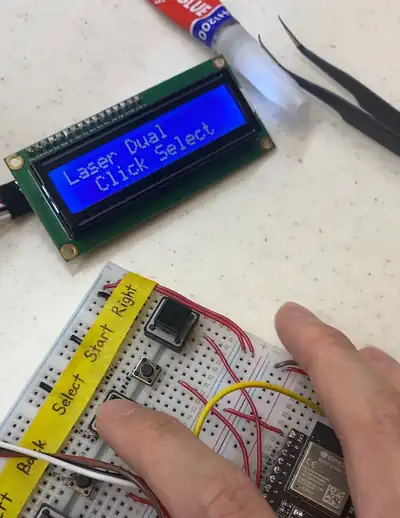
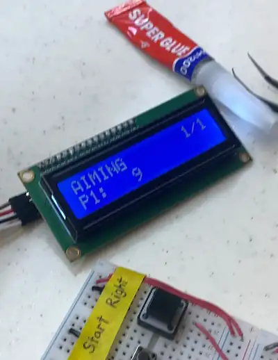
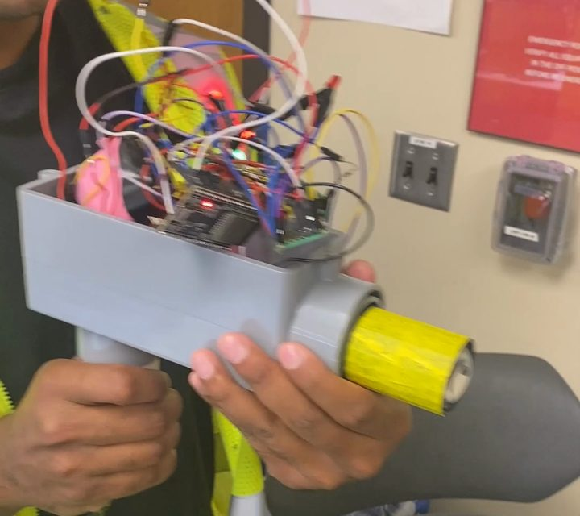
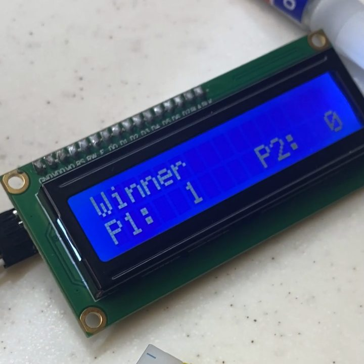
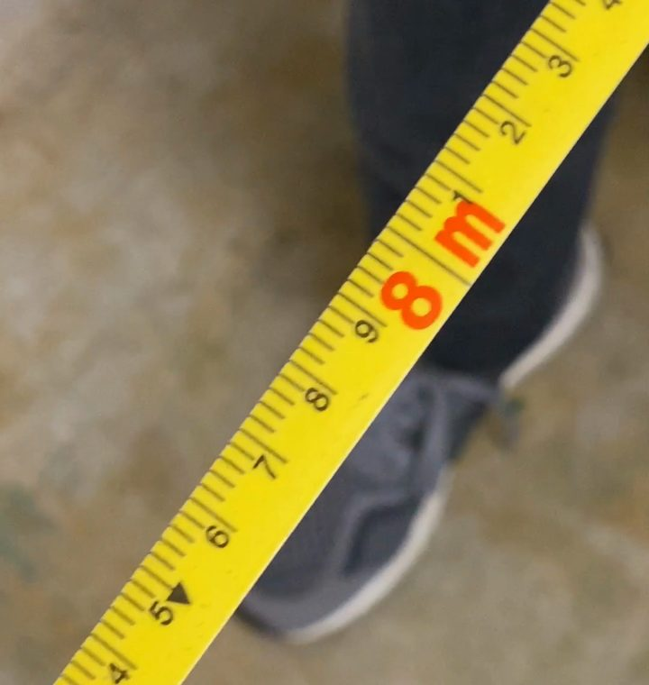
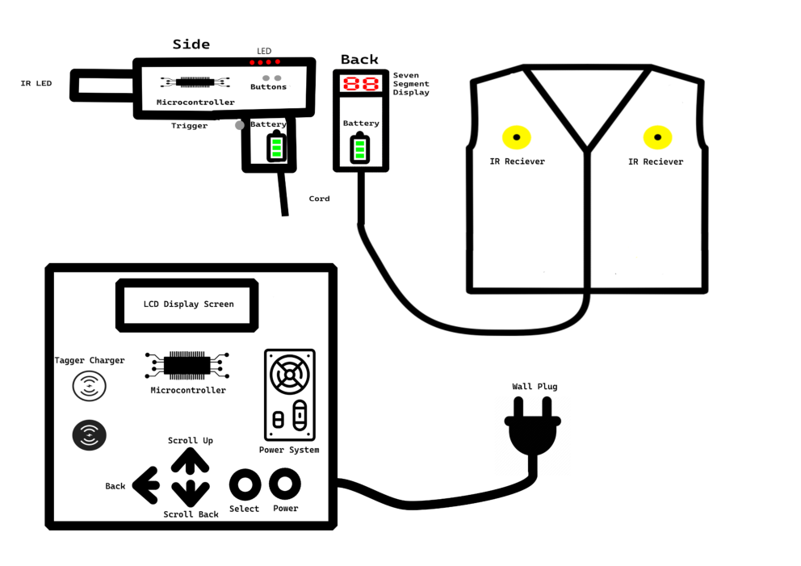
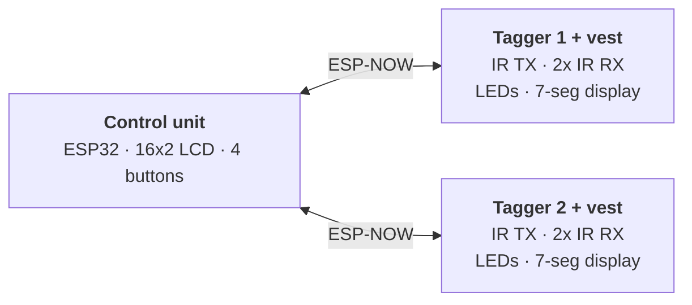
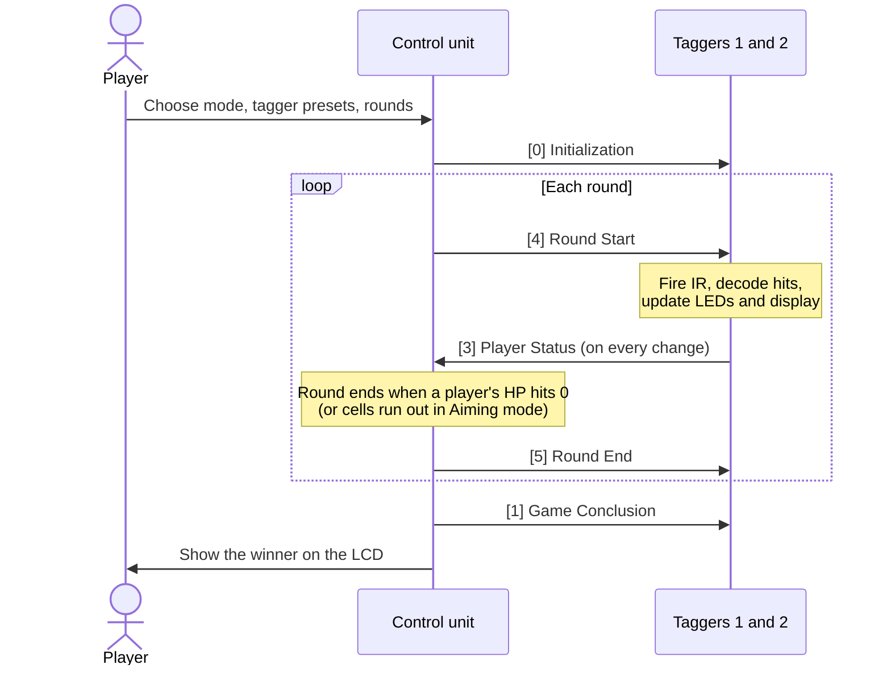
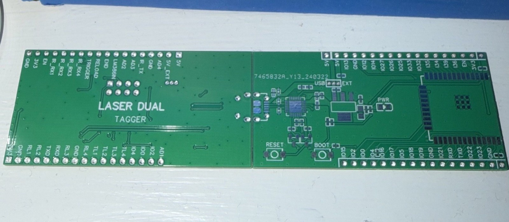
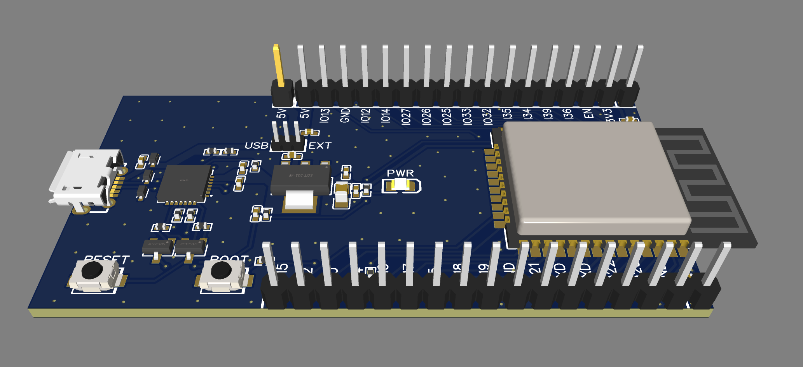

# Laser Dual

[](https://github.com/jonathan-kao/laser-dual/actions/workflows/firmware.yml)


A two-player laser tag system built on ESP32 microcontrollers and MicroPython.
Each player has an IR tagger and a vest with IR receivers; a control unit with
an LCD lets players pick a game mode and tagger presets, then coordinates the
game over ESP-NOW and keeps score.

Senior design project (Team 4) by Gavin Jay Gill, Pravin S. Jayatissa,
Jonathan Kao and Noble (Yi-Tso) Huang, spring 2024.

## Demo

Clips and frames from the team's demo video of the prototype (spring 2024).
The clips play in real time; people in the video are cropped out.

<p align="center">
  
  <br>
  <em>Left: game setup on the control unit (mode, Tagger 1 preset, rounds, summary).
  Right: Aiming mode, the score rising from 9 to 14 as shots hit the target board.</em>
</p>

<p align="center">
  
  
  <br>
  <em>Left to right: the tagger prototype (IR emitter in the yellow barrel), the winner
  screen after a two-player game, and the IR range test at 8 m.</em>
</p>

## Highlights

- **Three networked ESP32 boards, no access point.** The control unit and both
  taggers exchange a small text protocol over ESP-NOW, peer-to-peer.
- **Event driven, no threads.** ESP-NOW receive callbacks and IR pin interrupts
  let the radio and the IR decoder work alongside the main game loop.
- **Measured, not assumed.** ESP-NOW send-plus-ACK latency was at most about
  27 ms within 10 m, and the IR link worked at 8+ m (measurements in design
  doc sections [4.2.7](docs/design-doc.md#427-specification-measurements) and
  [4.3.7](docs/design-doc.md#437-specification-measurements)).
- **Custom hardware.** I designed both 2-layer PCBs (control unit and tagger)
  in EasyEDA, from schematic to Gerbers, BOM and pick-and-place, in
  [`hardware/`](hardware). The tagger board was fabricated, but the demo
  prototype ran on hand-wired dev boards (see
  [Known limitations](#known-limitations)).
- **Shown working.** [Demo](#demo) clips and frames from the prototype.
- **Documented end to end.** Full [design document](docs/design-doc.md),
  message format spec and third-party attribution.

## My role

I owned the **Game Software and ESP-NOW Connection** subsystem and designed
both PCBs.

**Firmware and protocol**

- Designed the ESP-NOW message protocol used between the control unit and the
  taggers ([message format](docs/esp-now-message-format.pdf)).
- Wrote the control unit firmware ([`firmware/control_unit.py`](firmware/control_unit.py)):
  the LCD menu for mode / tagger / round selection, the game coordinator that
  tracks player status and decides round and game ends, and an initialization
  retry loop (bypassed in this version, see [Known limitations](#known-limitations)).
- Built the tagger-side ESP-NOW handling and game flow in
  [`firmware/tagger_1.py`](firmware/tagger_1.py) / [`tagger_2.py`](firmware/tagger_2.py)
  together with Noble Huang, who owned the IR and LED logic.

**PCB design** (EasyEDA, [`hardware/`](hardware))

- Drew the schematics and laid out both 2-layer boards, the control unit and
  the tagger, and produced the BOMs, Gerbers and pick-and-place files for
  fabrication and assembly.
- Both boards are built around an ESP32-WROOM-32E with on-board programming
  and power: CP2102N USB-to-UART, transistor auto-reset/boot circuit, USB ESD
  protection, AMS1117 3.3 V regulator and USB or external 5 V input selection.
  The control unit board also carries the four menu buttons (Select, Back,
  Left, Right) and the LCD's 5 V connector; the tagger board adds a separate
  peripheral section with the 74HC595 display driver and headers for the IR,
  LED and button wiring.
- Prepared a second control unit BOM and pick-and-place set that leaves the
  ESP32 module, menu buttons, pin headers and LCD connector off the factory
  assembly.
- See also my [schematic review](docs/schematic-review-game-software.pdf) for
  the game software subsystem.

The circuits for the other subsystems (user interface, IR/LED, power) were
designed by their owners; see [Team Structure](docs/design-doc.md#5-team-structure).

## How it works

<p align="center">
  <br>
  <em>Product sketch from the design document</em>
</p>

The control unit and the two taggers talk peer-to-peer over ESP-NOW (no Wi-Fi
access point). The taggers shoot each other with NEC-encoded IR at 38 kHz.



| ID | Message | Direction | Payload |
|---|---|---|---|
| 0 | Initialization | Control unit to taggers | `0 <mode> <tagger1> <tagger2> <rounds>` |
| 1 | Game Conclusion | Both ways | `1` |
| 3 | Player Status | Taggers to control unit | `3 <hp> <cells>` |
| 4 | Round Start | Control unit to taggers | `4 <round>` |
| 5 | Round End | Control unit to taggers | `5 <round>` |

The [message format spec](docs/esp-now-message-format.pdf) also defines a
**[2] Initialization Acknowledgement**; the firmware does not use it and relies
on ESP-NOW's built-in delivery ACK instead.

A game runs like this:



A player can also end the game early with the End button: the tagger sends
**[1] Game Conclusion**, and the control unit forwards it to both taggers.

### Game modes

| Mode | Players | Rules |
|---|---|---|
| Health | 2 | 4 HP each. Damage per hit depends on the opponent's tagger. Reload allowed. |
| Aiming | 1 | Tagger 2 becomes a target board that lights a random target; score points until cells run out. |
| Showdown | 2 | Unlimited cells, fixed fire rate, one hit wins the round. |

### Tagger presets

| Preset | Damage dealt (HP) | Reload time | Cells (shots) | Fire interval |
|---|---|---|---|---|
| SWIFT | 1 | 1 s | 15 | 300 ms |
| PULSE | 2 | 2 s | 8 | 560 ms |
| NOVA | 4 | 4 s | 2 | 1200 ms |

### Hardware

Custom 2-layer PCBs for the control unit and the tagger/vest, built around the
ESP32-WROOM-32E module (designed by me in EasyEDA).

<table>
  <tr>
    <td align="center" valign="top" width="50%"><br><em>Tagger PCB (fabricated)</em></td>
    <td align="center" valign="top" width="50%"><br><em>Control unit PCB (3D render)</em></td>
  </tr>
</table>

## Repository layout

```
firmware/
  control_unit.py         Control unit: LCD menu + game coordinator
  tagger_1.py             Player 1 tagger/vest
  tagger_2.py             Player 2 tagger/vest (also the Aiming-mode target board)
  lib/                    Third-party MicroPython libraries (see THIRD_PARTY_NOTICES.md)
    ir_rx/  ir_tx/        NEC IR receive/transmit (peterhinch/micropython_ir)
    lcd_api.py            HD44780 LCD API (dhylands/python_lcd)
    i2c_lcd.py            LCD over a PCF8574 I2C backpack (dhylands/python_lcd)
  display/display.py      7-segment display driver used by the taggers (UI subsystem)
  tools/print_mac_addr.py Print a board's MAC address for the ESP-NOW peer list
hardware/
  README.md               Guide to the board files
  control-unit/           Schematic, PCB layout, 3D render, Gerbers, BOM, pick-and-place
  tagger/                 Same for the tagger/vest board, plus a photo of the PCB
docs/
  design-doc.md           Full design document
  media/                  Demo clips and frames from the prototype video
  esp-now-message-format.pdf
  schematic-review-game-software.pdf
```

## Running it

Hardware: three ESP32 boards (control unit + two taggers), flashed with
MicroPython v1.20 or newer (for the `espnow` module). The pin numbers in the
firmware match the hand-wired prototype, not the PCB schematics (see
[Known limitations](#known-limitations)). The taggers use classic ESP32 pins.
The control unit uses GPIO 6-12, which rules out an ESP32-WROOM-32E (GPIO 6-11
are its flash pins), so it most likely ran on an ESP32-S2 or S3 board.

1. Run `firmware/tools/print_mac_addr.py` on each board and update the peer MAC
   addresses at the top of `control_unit.py`, `tagger_1.py` and `tagger_2.py`.
2. Copy the libraries and the firmware with
   [`mpremote`](https://docs.micropython.org/en/latest/reference/mpremote.html).
   Control unit:

   ```bash
   mpremote cp -r firmware/lib : + cp firmware/control_unit.py :main.py
   ```

   Tagger 1 (Tagger 2 is the same with `tagger_2.py`):

   ```bash
   mpremote cp -r firmware/lib : + cp -r firmware/display : + cp firmware/tagger_1.py :main.py
   ```

3. Power on the taggers first, then the control unit, and press **Select**.

## Known limitations

- `firmware/display/display.py` is reconstructed. The copy deployed to the
  taggers was not kept, so it was rebuilt from the surviving bench-test driver
  with two changes: it uses the digit pins passed in by the tagger, and it no
  longer runs a demo on import. The file header lists both changes.
- `control_unit.py` overrides the initialization ACK results, so a game starts
  even with only one tagger online (most likely left in from single-tagger
  testing). The retry loop therefore never triggers; removing the two override
  lines restores it.
- Peer MAC addresses are hard-coded.
- The firmware pin numbers do not match the PCB schematics in `hardware/`. The
  demo video shows the prototype running on hand-wired dev boards: a
  breadboarded control unit and tagger electronics wired inside the housing.
  Tagger 1 and tagger 2 even use different display pins. Running the firmware on
  the PCBs would need the pin constants at the top of each file updated; the
  vest IR receiver pins (36 and 39) already match. For example, the tagger PCB
  routes the 74HC595 data/latch/clock to IO4/IO2/IO0 and the digit selects to
  IO15/IO27/IO14/IO13, while `tagger_1.py` uses 21/27/26 and 13/2/12/19.

## Credits

- Team members: see [Team Structure](docs/design-doc.md#5-team-structure).
- IR encoding/decoding: [micropython_ir](https://github.com/peterhinch/micropython_ir)
  by Peter Hinch (MIT).
- LCD driver: [python_lcd](https://github.com/dhylands/python_lcd) by Dave
  Hylands (MIT).

Details and license texts are in [THIRD_PARTY_NOTICES.md](THIRD_PARTY_NOTICES.md).
