# Laser Dual - Design Document

**Team 4:** Gavin Jay Gill, Pravin S. Jayatissa, Jonathan Kao, Noble (Yi-Tso) Huang
**TA:** Shengtai Ju | **Professor:** Ryan Beasley
**Revision:** 5 (2024-04-26)

> This is a Markdown version of the team's final design document (originally a PDF).
> Content is kept as written; formatting was cleaned up, and the team members'
> photos and contact details were left out.

  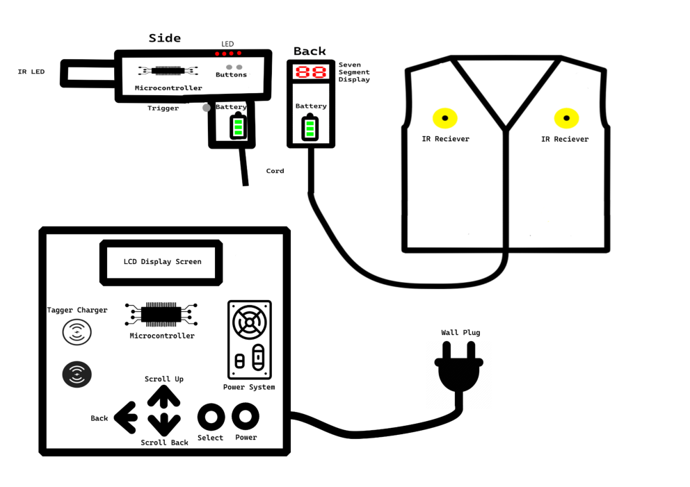 
  <em>Figure 0.1: Product sketch</em>

## Contents

- [Revision Log](#revision-log)
- [Glossary](#glossary)
- [1 Introduction](#1-introduction)
- [2 Design Requirements](#2-design-requirements)
- [3 System Overview](#3-system-overview)
- [4 Subsystems](#4-subsystems)
  - [4.1 User Interface](#41-subsystem-1-user-interface)
  - [4.2 Game Software and ESP-NOW Connection](#42-subsystem-2-game-software-and-esp-now-connection)
  - [4.3 IR Game Logic and LED System](#43-subsystem-3-ir-game-logic-and-led-system)
  - [4.4 Power System](#44-subsystem-4-power-system)
- [5 Team Structure](#5-team-structure)

## Revision Log

| Date | Revision | Changes |
|---|---|---|
| 1/24/2024 | 1 | Initial revision |
| 2/2/2024 | 2 | Updated user story; updated block diagram; updated power requirements; added initial subsystem design section |
| 3/6/2024 | 3 | Updated schematics; updated specification measurements; updated parts; updated theory of operation / algorithm |
| 4/12/2024 | 4 | Added final status |
| 4/26/2024 | 5 | Removed blank page; fixed revision log; fixed team section |

## Glossary

| Term | Definition |
|---|---|
| IR | Infrared. |
| Tagger | A device that emits an infrared pulse (beam) for targeting in the game. |
| Vest | A garment that detects the infrared pulse (beam) and displays the health bar of the player. |
| Control Unit | A versatile hub that changes game modes, displays scores and recharges taggers, using ESP-NOW to communicate with the taggers. |
| Health Mode | A two-player game mode where each player has a health bar. Players can individually select the specifications of their taggers. The health bar decreases when the IR receivers on a player's vest detect an incoming IR pulse. This mode emphasizes endurance and accuracy, as players aim to deplete their opponent's health bar to win. |
| Aiming Mode | A solo-player game mode designed for practicing accuracy and marksmanship. One tagger-vest set is used as a stationary target board, with each IR receiver on the vest assigned different point values. The other tagger-vest set is worn by the player, who can customize the specifications of their tagger. The game focuses on hitting the targets on the stationary vest to accumulate points. The game concludes when the player's ammunition is depleted. |
| Showdown Mode | A competitive two-player game mode focusing on quick reflexes and precision. The taggers' speakers emit a countdown sound; at the end of the countdown, players rapidly attempt to hit the IR receivers on their opponent's vest. The first player to hit an opponent's receiver in each round earns a point. Players select the number of rounds; at the end, the game displays the total points of each player and determines the winner. |
| ESP-NOW | A connectionless communication protocol by Espressif used for short packet transmission. |
| I2C | Synchronous, multi-master, multi-slave serial communication bus. |

## 1 Introduction

### 1.1 Executive Description

This product is an interactive gaming system, akin to laser tag, designed for dual-player engagement. It comprises two sets of taggers and vests, accompanied by a control unit. The control unit serves as the central hub, enabling users to choose from a variety of game modes, and communicates the selected mode to the corresponding vests and taggers. The primary objective of this product is to provide an enjoyable gaming experience for two people, fostering shared entertainment and recreation.

### 1.2 User Story

Scott and Elsie found themselves longing for a laser tag experience with no location nearby to play, which led them on a quest to bring the excitement home. Disappointed by the overpriced and underwhelming options at the store, they stumbled upon the Laser Dual set, promising to redefine their laser tag adventures.

The Laser Dual set immediately captured their attention with its innovative features. The tagger and vest boasted real-time displays, allowing them to keep track of shots and monitor their health effortlessly. No more fumbling with reloads - a simple button press got them back in the game.

As the duo delved into the world of Laser Dual, they discovered the joy of customization. The control unit became their go-to hub for game mode changes, offering the flexibility to tweak shooting speeds and ammo levels. They seamlessly transitioned between different modes, keeping the excitement alive.

Approaching the interactive control unit, Scott and Elsie were impressed with its user-friendly interface. A quick press of a button not only adjusted their game settings but also announced their chosen game mode through a built-in speaker and visual display.

When fatigue eventually set in, Laser Dual continued to impress. Placing their taggers back on the control unit ensured they were recharged and ready for the next round. No more scouring for batteries or dealing with messy charging cables.

## 2 Design Requirements

### 2.1 Requirements

1. The system must support two players.
2. The tagger must display ammo count.
3. The tagger must be able to reload.
4. The tagger must not look like a real gun.
5. The tagger must display health.
6. The vest must illuminate the targets.
7. The control unit must be able to change game modes.
8. The control unit must be able to change how the tagger fires.
9. The control unit must announce the game mode.
10. The control unit must recharge the taggers and vests.
11. The tagger must not be hazardous to the eyes when fired.
12. The tagger must have a battery that weighs less than 1.5 pounds.
13. The tagger's battery must last at least 30 minutes.
14. The system must include a real-time scoring mechanism that accurately records hits and assigns points, differentiating between the two players.
15. The software must offer multiple game mode options with different rules and scoring systems.
16. The control unit should last 20 hours.
17. The control unit should have a battery that weighs less than 7.5 lbs.

### 2.2 Factors Influencing Requirements

- **Public health, safety and welfare**
  - Limiting the system to two players minimizes the risk of accidents and overcrowding.
  - Non-hazardous features, such as a tagger that is not hazardous to the eyes, prioritize player well-being.
- **Global factors**
  - Aligning with global trends toward non-violent and inclusive gaming experiences.
- **Cultural factors**
  - The tagger does not resemble a real gun, to respect cultural sensitivities.
  - The game is designed to respect diverse cultural backgrounds and preferences.
- **Social factors**
  - Fostering positive social interactions among participants.
- **Environmental factors**
  - The control unit recharges the taggers and vests, minimizing disposable batteries.
  - Energy-efficient technology in the tagger and vest reduces environmental impact.
- **Economic factors**
  - Limiting the system to two players keeps it affordable and avoids excessive equipment costs.

### 2.3 Final Status

1. The system supports two players.
2. The tagger displays ammo count.
3. The tagger can reload.
4. The tagger does not look like a real gun.
5. The vest displays health.
6. The vest illuminates the targets.
7. The vest can revive the user.
8. The control unit is able to change game modes.
9. The control unit can change how the tagger fires.
10. The control unit can display the game mode.
11. The control unit can recharge the taggers and vests.
12. The tagger is not hazardous to the eyes when fired.
13. The tagger has a battery that weighs 1.2 pounds.
14. The tagger's battery lasts at least 1 hour.
15. The system includes a real-time scoring mechanism that accurately records hits and assigns points, differentiating between the two players.
16. The software offers multiple game mode options with different rules and scoring systems.
17. The control unit's battery life is untested.
18. The control unit has a battery that weighs less than 7.5 lbs.

## 3 System Overview

### 3.1 System Block Diagram

  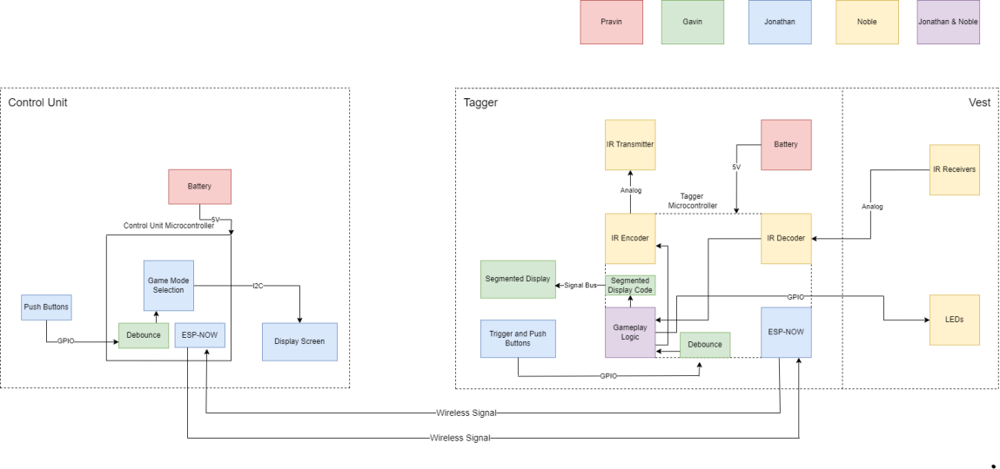 
  <em>Figure 3.1: System-level UML2 block diagram</em>

### 3.2 System Activity Diagram

  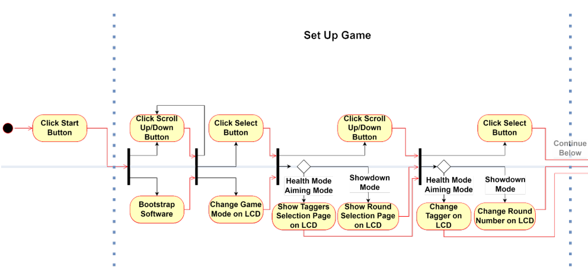 
  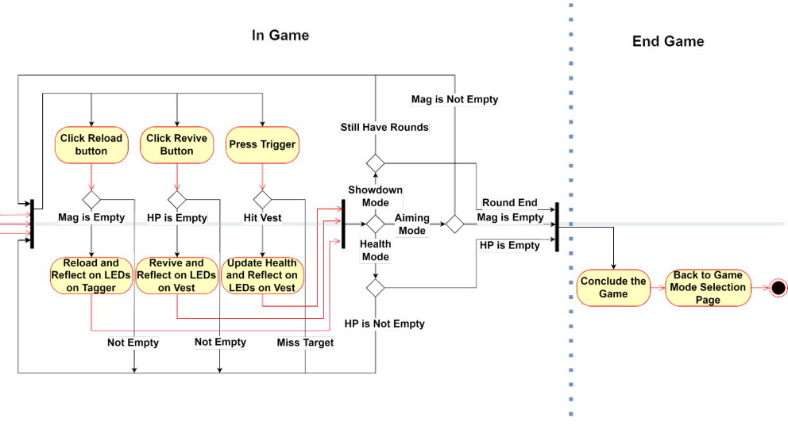 
  <em>Figure 3.2: System-level UML2 activity diagram</em>

## 4 Subsystems

### 4.1 Subsystem 1: User Interface

**Owner:** Gavin Gill

#### 4.1.1 Subsystem Diagram

  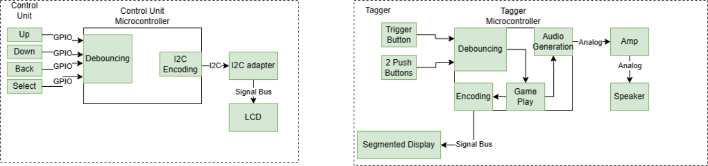 
  <em>Figure 4.1: User interface diagram</em>

#### 4.1.2 Specifications

1. The tagger must have a 4-digit seven-segment display that can display numbers and characters.
2. The tagger's 4-digit seven-segment display must be visible in a room with lights on.
3. The tagger's 4-digit seven-segment display must be able to display more than 4 elements.
4. The tagger must have three push buttons that are debounced.
5. The control unit must have 4 push buttons that are debounced.

#### 4.1.3 Subsystem Interactions

- For the game mode software, this module provides the button input on the tagger.
- It displays the information the game mode requires on the seven-segment display, through a function that takes a string and shows it on the display.
- It plays audio when required by the game, through a function called by the software.
- For the game mode selection software, this module provides the LCD hardware that the software interacts with.
- All power for this module is provided by the 3 V output of the microcontroller.
- All communication with this module goes through functions in the software.

#### 4.1.4 Theory of Operation / Algorithm

**Button debouncing.** An object-oriented debouncing class in Python acts as a software shift register. Once all the registers show that the button is pressed, the button sets its `pressed` value to true. It also has a value that is set true only once, to mark the moment the button had a falling edge.

**Seven-segment display.** A physical shift register is used to save pins. The data for one element is sent to the shift register; that element is presented to all digits of the display, so for each element the digits that should not show it are turned off. The driver then moves to the next element and repeats. This is done rapidly so the user perceives all elements as displayed at the same time.

#### 4.1.5 Core ECE Design Tasks

- **Microcontrollers:** programming in a microcontroller environment and interfacing microcontroller inputs and outputs with other modules and peripherals (ECE 362 Microprocessor Systems and Interfacing, ECE 40862 Software for Embedded Systems).
- **Communication standards:** formatting information on a bus and wiring it to communicate properly with the microcontroller (ECE 362).

#### 4.1.6 Schematics / Parts / Algorithms

  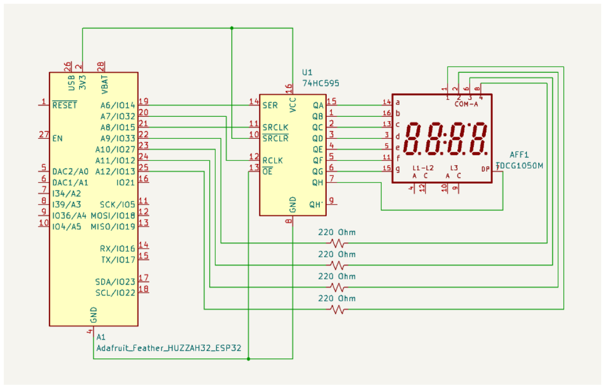 
  <em>Figure 4.2: Seven-segment display schematic</em>

  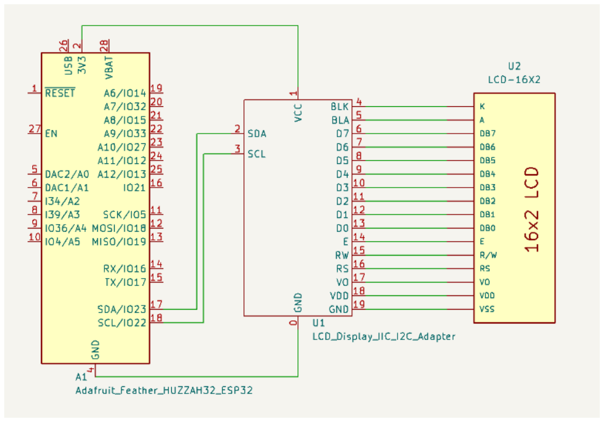 
  <em>Figure 4.3: LCD with I2C adapter schematic</em>

**Parts**
- 3 microcontrollers
- 10 push buttons
- 1 I2C converter
- 1 LCD
- 2 4-digit seven-segment displays

**Algorithms** (software written in MicroPython)
- I2C encoding algorithm
- Seven-segment encoding algorithm
- Debouncer algorithm

**Libraries**
- `machine`
- `MyKitSwitch`

#### 4.1.7 Specification Measurements

- The 4-digit display can display "the quick brown fox jumped over the lazy dog 1233456789".
- The 4-digit display is visible in the lab with the lights on.
- The buttons can be pressed to increment on each press.
- A button can be held to increment continuously.

#### 4.1.8 Standards

- **I2C:** a synchronous, multi-master, multi-slave serial communication bus.

### 4.2 Subsystem 2: Game Software and ESP-NOW Connection

**Owner:** Jonathan Kao

#### 4.2.1 Subsystem Diagram

  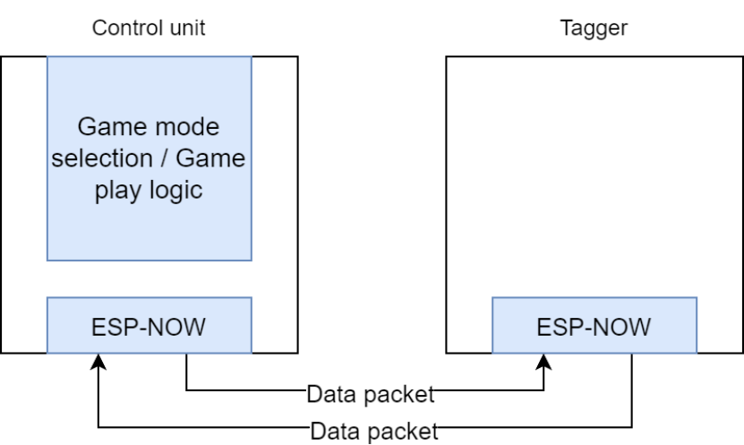 
  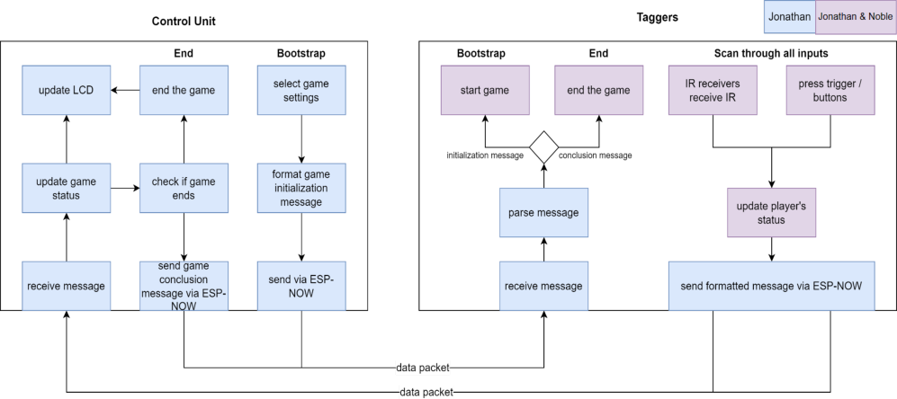 
  <em>Figure 4.4: Subsystem 2 block diagram (the tagger-side blocks are shared with subsystem 3)</em>

#### 4.2.2 Subsystem Interactions

- Within the control unit, this subsystem receives and processes the signals from the control unit's buttons and outputs to the LCD.
- It sends game start messages with the chosen settings from the control unit to the taggers' microcontrollers.
- On the taggers, it receives processed data from the gameplay block and transmits it to the control unit's microcontroller via ESP-NOW.

#### 4.2.3 Theory of Operation / Algorithm

**ESP-NOW message formatting guide.** This guide keeps the game logic consistent across subsystems. The standalone version is in [esp-now-message-format.pdf](esp-now-message-format.pdf).

| Type | Name | Direction | Format | Example |
|---|---|---|---|---|
| 0 | Initialization: sets game parameters | control unit -> taggers | `[type] [game mode] [tag-1] [tag-2] [round]` | `0 0 1 2 1` |
| 1 | Game conclusion: signals the game's end | control unit <-> taggers | `[type]` | `1` |
| 3 | Player status update: current health and cell number | tagger -> control unit | `[type] [health bar] [cell number]` | `3 2 11` |
| 4 | Round start | control unit -> taggers | `[type] [round]` | `4 2` |
| 5 | Round end | control unit -> taggers | `[type] [round]` | `5 3` |

The sender of a player status update is identified by its MAC address.

**Managing game conclusion.** Both the control unit and the taggers can initiate the end of a game, under different conditions:

1. **Tagger-initiated end**
   - *Condition:* only when a player explicitly presses the stop (End) button.
   - *Procedure:* the tagger sends an end message to the control unit; the control unit acknowledges the request and then sends end messages to all taggers.
   - *Note:* the tagger should not initiate the end process unless the stop button is pressed. Normally the control unit monitors player status through Player Status Update messages and decides when to end the game based on the gameplay criteria.
2. **Control-unit-initiated end**
   - When the control unit detects that the game is complete (e.g., objectives achieved, time limit reached), it sends end messages directly to all taggers.

**Enumerations**

| Game mode | | Tagger configuration | | Game parameter | Range |
|---|---|---|---|---|---|
| 0 | Health | 0 | N/A (no P2 in Aiming mode; no tagger choice in Showdown mode) | Round | 1 to 10 |
| 1 | Aiming | 1 | SWIFT | Health bar | 0 to 4 |
| 2 | Showdown | 2 | PULSE | Cell number | 2 to 15 |
| | | 3 | NOVA | | |

**Game logic on the control unit**

1. Send [0] Initialization to the taggers after the game parameters are set.
2. Send [4] Round Start. *(The original PDF says "[5] Round End" here; the firmware sends [4] Round Start.)*
3. Continuously receive [3] Player Status Update and [1] Game Conclusion.
4. When a [3] Player Status Update is received, check whether the round ends based on the player's status.
5. If the round ends, send [5] Round End and check whether it was the last round. If so, send [1] Game Conclusion.
6. If a [1] Game Conclusion is received, broadcast [1] Game Conclusion to all taggers.
7. After sending [1] Game Conclusion, display the game conclusion page on the control unit.
8. When the player presses the Select button, return to game parameter selection and go to step 1.

#### 4.2.4 Specifications

1. The subsystem's software must be developed in MicroPython.
2. The subsystem handles the selection and setup of Health, Aiming and Showdown modes.
3. Real-time communication between the taggers and the control unit uses ESP-NOW.
4. ESP-NOW and the IR protocol must operate at the same time without threading.
5. ESP-NOW packets must be transmitted and acknowledged within 0.5 seconds.

#### 4.2.5 Core ECE Design Tasks

- **Microcontroller programming:** handling peripheral inputs and outputs and designing the processes between them in MicroPython (ECE 362 Microprocessor Systems and Interfacing, ECE 40862 Software for Embedded Systems).
- **Wireless communication:** understanding and implementing the ESP-NOW protocol (ECE 50863 Computer Network Systems).

#### 4.2.6 Schematics / Parts

  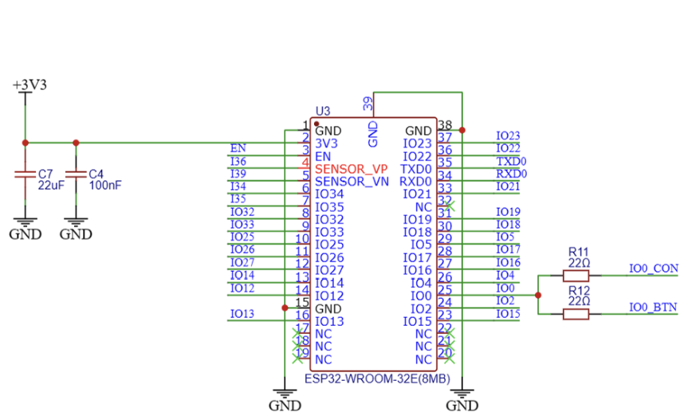 
  <em>ESP32 module</em>

  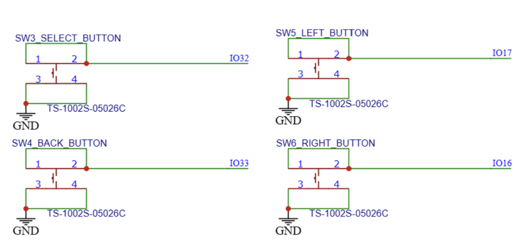 
  <em>Peripheral buttons</em>

  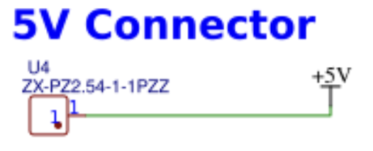 
  <em>5 V connector for the I2C LCD adapter</em>

| Name | Qty | Manufacturer | Supplier | Supplier part | Price (USD) |
|---|---|---|---|---|---|
| TS-1002S-05026C (push button) | 4 | XUNPU | LCSC | C455110 | 0.038 |
| ZX-PZ2.54-1-1PZZ (connector) | 1 | Megastar | LCSC | C7501259 | 0.019 |

More detail on this subsystem (software design, activity diagrams, game mode selection flow and LCD page designs) is in [schematic-review-game-software.pdf](schematic-review-game-software.pdf).

#### 4.2.7 Specification Measurements

Control unit serial output while a game runs (parameter selection, [0] Initialization and [4] Round Start sent, [3] Player Status Updates received, then [1] Game Conclusion received and broadcast):

  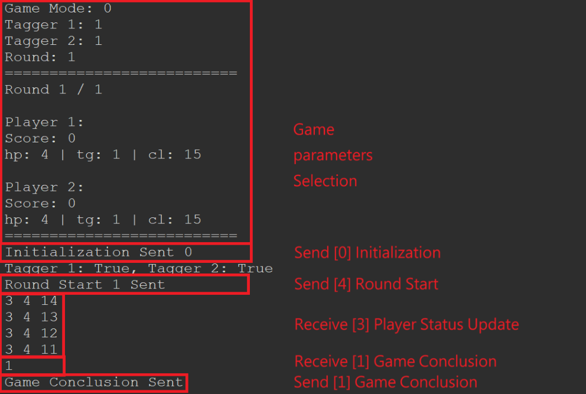 
  <em>Control unit serial output during a game</em>

Tagger serial output (receives [0] Initialization and [4] Round Start):

  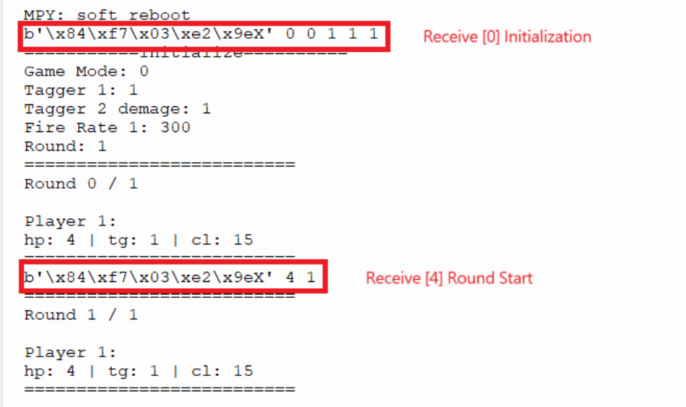 
  <em>Tagger serial output during a game</em>

  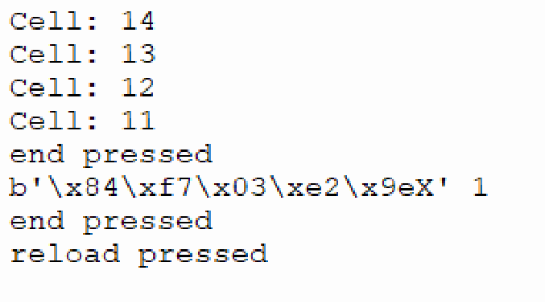 
  <em>Tagger serial output when the buttons are pressed</em>

When the player presses the trigger, the cell count decrements, the tagger emits an IR signal and sends a [3] Player Status Update to the control unit. When the player presses the End button, the tagger sends [1] Game Conclusion to the control unit, which then broadcasts it to all taggers.

The most recent measurement of the ESP-NOW transmission delay, including both sending and acknowledgment, was at most about **0.027 s** within a range of 10 meters.

  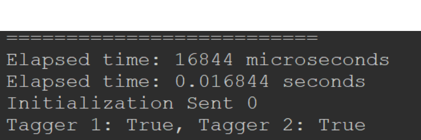 
  <em>ESP-NOW connection time measurement</em>

#### 4.2.8 Standards

- **ESP-NOW:** a connectionless protocol by Espressif for short packet transmission.
- **IEEE 802.11:** to understand and mitigate potential interference with Wi-Fi networks and ensure reliable message transmission.
- **IEEE 1588:** precise synchronization between the control unit and the taggers, important for game integrity and timing.

### 4.3 Subsystem 3: IR Game Logic and LED System

**Owner:** Noble (Yi-Tso) Huang

#### 4.3.1 Subsystem Diagram

  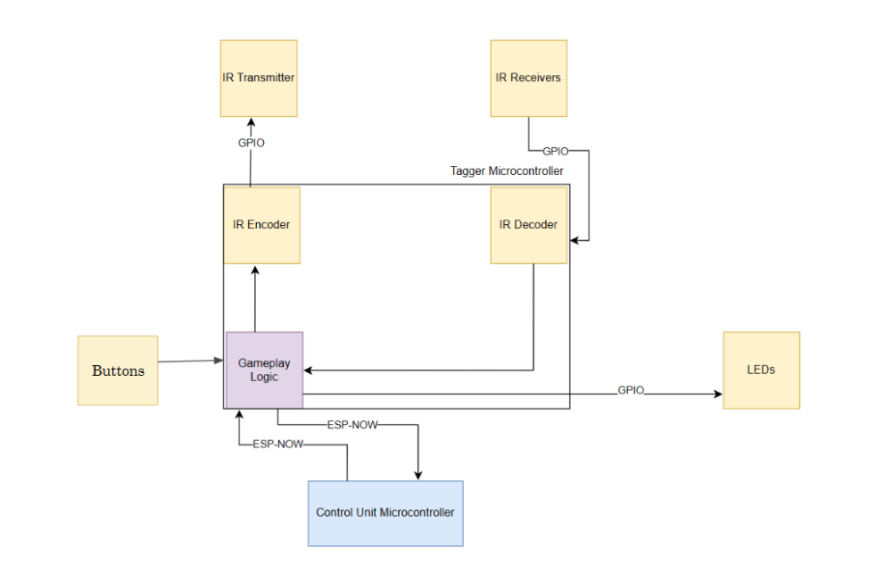 
  <em>Figure 4.5: Subsystem 3 block diagram</em>

#### 4.3.2 Subsystem Interactions

- The IR receivers and LEDs operate at 3.3 V and the IR transmitter at 5 V, both provided by the tagger's microcontroller.
- The IR receivers send the received data to the tagger's microcontroller.
- The IR transmitter transmits data provided by the tagger's microcontroller.
- The tagger's microcontroller processes the data from the IR receivers and sends it to the control unit.
- The tagger's microcontroller processes the data from the control unit and applies it to the tagger and vest.

#### 4.3.3 Theory of Operation / Algorithm

The tagger first waits for a message from the control unit. After receiving it, the tagger initializes its game parameters from the message.

**Health mode.** The health bar LEDs light up in sequence; once they are all lit, the game starts. Whenever the player is hit, LEDs turn off and the tagger sends a player status update to the control unit. When all LEDs are off, the round ends and the tagger waits for a message from the control unit. The player can use three buttons: Trigger, Reload and End.

**Aiming mode.**
- *Tagger 1* is the shooter. Pressing the trigger emits an IR beam; each hit on the target earns a point. The game ends when the tagger runs out of cells. Buttons: Trigger, Reload and End.
- *Tagger 2* is the target. One of the target LEDs lights up until the IR receiver beside it is hit. After a hit, the LED turns off and another randomly chosen LED (possibly the same one) lights up. The game ends when the shooter runs out of cells. Buttons: Trigger, Reload and End.

**Showdown mode.** The health bar LEDs light up in sequence; once they are all lit, the game starts. When the player is hit, the round ends and the tagger waits for a message from the control unit. Buttons: Trigger and End.

#### 4.3.4 Specifications

1. The vest must have 2 IR receivers that can decode data from 4+ meters.
2. The vest must have 2 LEDs.
3. The tagger must have 4 LEDs.
4. The tagger must have an IR transmitter that can transmit data for 4+ meters.
5. The subsystem must handle the tagger's gameplay logic.
6. The subsystem must be coded in MicroPython.

#### 4.3.5 Core ECE Design Tasks

- **Microcontrollers:** handling the inputs and outputs of the peripherals (ECE 362).
- **Gameplay logic:** designing an algorithm that handles the different game modes (ECE 264, ECE 368).

#### 4.3.6 Schematics / Parts

  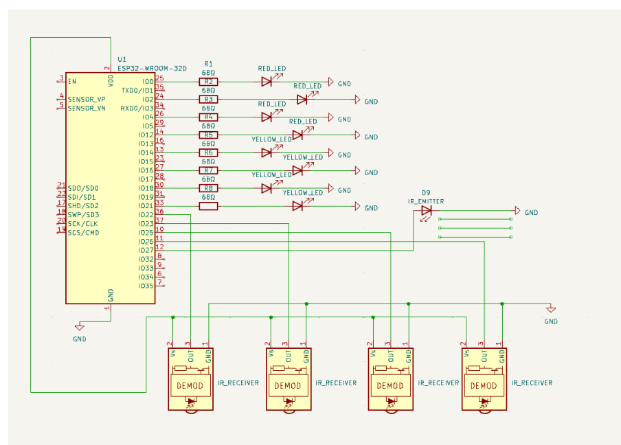 
  <em>IR emitter, IR receivers and LEDs</em>

  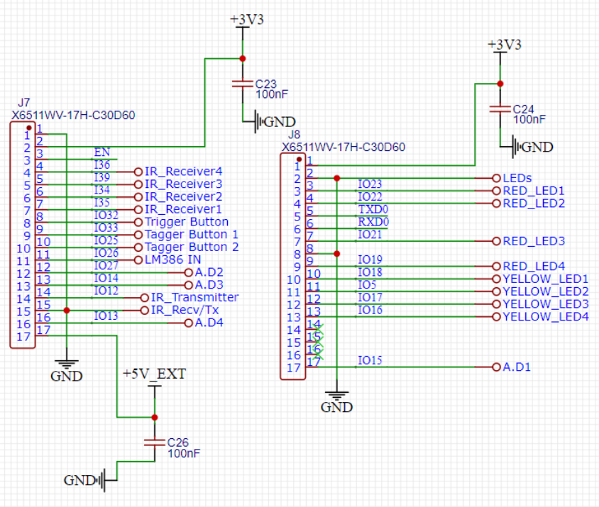 
  <em>Tagger peripheral connectors (J7, J8)</em>

  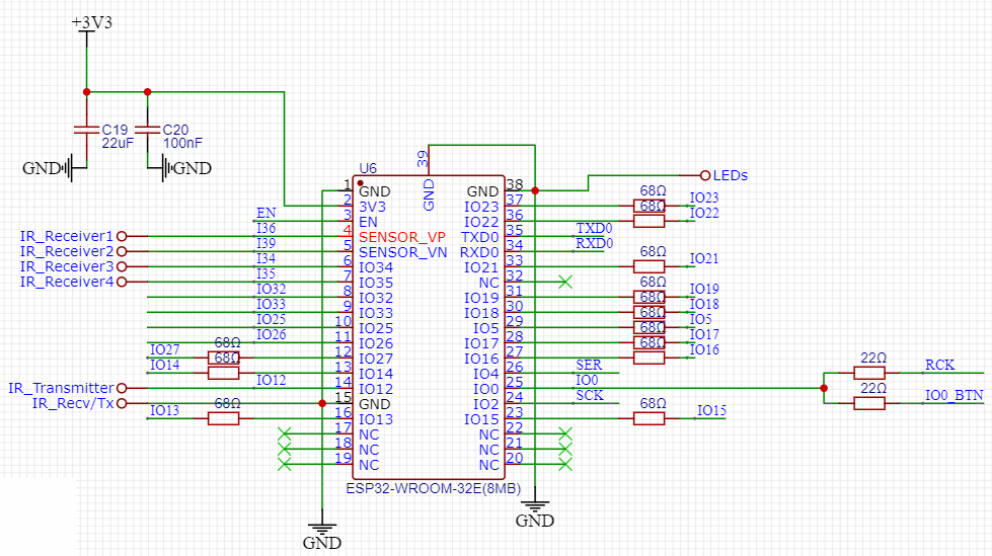 
  <em>Tagger ESP32 module</em>

| Name | Qty | Manufacturer part | Manufacturer | Supplier | Supplier part | Price (USD) |
|---|---|---|---|---|---|---|
| 68 Ohm resistor | 12 | CR0402-JW-680GLF | BOURNS | LCSC | C203195 | 0.005 |
| 38 kHz IR receiver | 4 | EK8477 | Gikfun | Amazon | N/A | 14.98 |
| 38 kHz IR transmitter | 2 | EK8477 | Gikfun | Amazon | N/A | 14.98 |
| LEDs | 12 | N/A | N/A | ECE shop | N/A | N/A |

#### 4.3.7 Specification Measurements

- The IR receiver can decode data transmitted from 4.5 meters (measured with a tape measure).
- The IR transmitter can transmit data over 4.5 meters (measured with a tape measure).
- The tagger prints a message when the Trigger, Reload and End buttons are pressed (see the tagger console output in 4.2.7).
- The valid range of the transmitter and receivers was measured as shown below; the result is 8+ meters.

  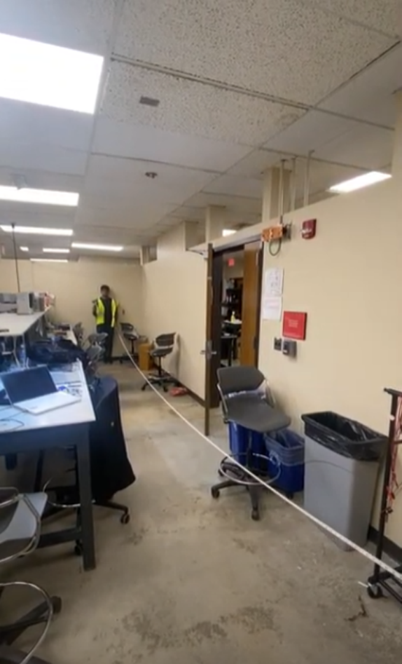 
  <em>IR range measurement setup</em>

#### 4.3.8 Standards

- **IEC 60825-1:2014:** an International Electrotechnical Commission standard on the safety of laser products, which specifies requirements and guidelines for the safe use of lasers and laser systems intended to be used by humans.

### 4.4 Subsystem 4: Power System

**Owner:** Pravin Jayatissa

#### 4.4.1 Subsystem Diagram

  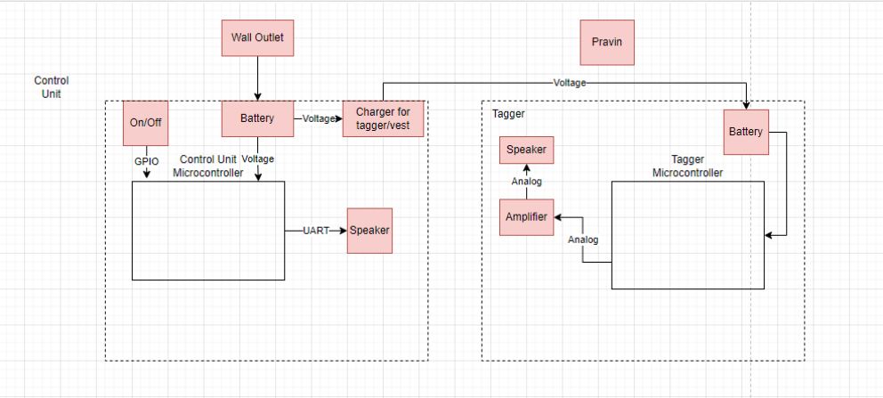 
  <em>Figure 4.6: Power system diagram</em>

#### 4.4.2 Subsystem Interactions

The power system supplies 5 V to the microcontrollers. In addition, the power system on the control unit is able to charge the tagger's battery.

#### 4.4.3 Theory of Operation / Algorithm

18 V charges the control unit's battery. A power multiplexer selects between the wall adapter and the battery using highest-voltage mode: without wall power it selects the battery; with wall power it selects the wall power.

The selected source goes to a voltage regulator that converts it down to 12 V. The 12 V branches off to an adapter for the tagger, and also to another regulator that converts it down to 5 V to power the control unit's microcontroller.

The tagger connects to the 12 V adapter with a cable. A boost converter raises the 12 V to 16 V, which charges the tagger's battery. The tagger's battery feeds another regulator that converts it down to 5 V for the tagger's microcontroller.

#### 4.4.4 Specifications

- The power system on the control unit must have a 12 V 12 Ah battery.
- The power system on the tagger must have a 12 V 1.4 Ah battery.
- The batteries must be charged with constant current, constant voltage.
- The control unit battery system must be able to charge the tagger battery.
- The power system must have buck converters that step down to 5 V.

#### 4.4.5 Core ECE Design Tasks

- Electrical Engineering Fundamentals II: battery charging and discharging, and battery safety protocol.
- Electrical Engineering Fundamentals II: DC-to-DC voltage converters.
- Electrical Engineering Fundamentals II: power selection circuit between wall power and the battery.

#### 4.4.6 Schematics / Parts

  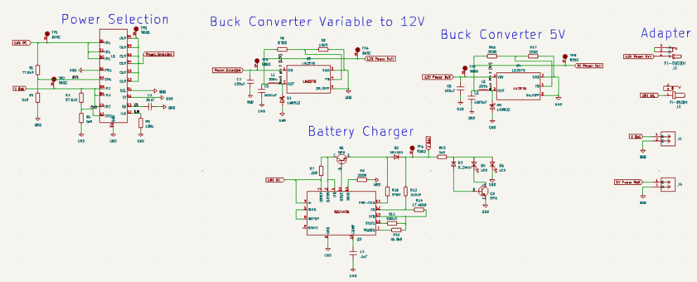 
  <em>Figure 4.6.1: Control unit power system schematic</em>

  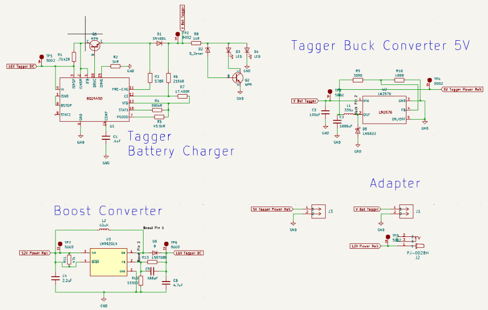 
  <em>Figure 4.6.2: Tagger power system schematic</em>

**Control unit parts**

| Item | Digi-Key part number | Qty |
|---|---|---|
| Jack | CP-002BH-ND | 2 |
| Screw connector | A98036-ND | 2 |
| Test point | 36-5002-ND | 8 |
| 77k resistor | 541-4512-1-ND | 1 |
| 5k resistor | PNM1206-5.0KBCT-ND | 2 |
| 57.6k resistor | 311-57.6KFRCT-ND | 1 |
| 100k resistor | P100KFCT-ND | 1 |
| 0.1 uF capacitor | 1276-1002-1-ND | 2 |
| Power mux | 595-TPS2124YFPR | 1 |
| Buck converter | LM2576T-5.0/NOPB-ND | 2 |
| 100 uF electrolytic capacitor | 732-8511-1-ND | 2 |
| 1000 uF electrolytic capacitor | PCE3462CT-ND | 2 |
| 1k resistor | 311-1.00KFRCT-ND | 3 |
| 1N5822 diode | 497-11370-1-ND | 2 |
| 330 uH inductor | SRR1260-331KCT-ND | 2 |
| 8760 Ohm resistor | 2019-RN73R1JTTD8761B25CT-ND | 1 |
| 3090 Ohm resistor | 311-3.09KFRCT-ND | 1 |
| Charger IC | 296-32836-5-ND | 1 |
| 1N4001 diode | 1N4001GOS-ND | 1 |
| BD242 BJT | BD242CGOS-ND | 1 |
| 45.9k resistor | 2019-RN73H1JTTD4592F100CT-ND | 1 |
| 590k resistor | 541-590KFCT-ND | 1 |
| 17.4k resistor | 311-17.4KFRCT-ND | 1 |
| 215k resistor | 311-215KFRCT-ND | 1 |
| 576 Ohm resistor | 311-576FRCT-ND | 1 |
| 350 Ohm resistor | 764-D55342E07B350ART5CT-ND | 1 |
| 0.25 Ohm resistor | CSR1206FKR250CT-ND | 1 |
| Zener diode | MM5Z12VT1GOSCT-ND | 1 |
| Transistor | 512-BC547B | 1 |
| Green LED | 732-4993-1-ND | 1 |
| Red LED | L62301CT-ND | 1 |

**Tagger parts**

| Item | Digi-Key part number |
|---|---|
| Jack | CP-002BH-ND |
| Screw connector | A98036-ND |
| Test point | 36-5002-ND |
| Buck converter | LM2576T-5.0/NOPB-ND |
| 100 uF electrolytic capacitor | 732-8511-1-ND |
| 1000 uF electrolytic capacitor | PCE3462CT-ND |
| 1k resistor | 311-1.00KFRCT-ND |
| 1N5822 diode | 497-11370-1-ND |
| 330 uH inductor | SRR1260-331KCT-ND |
| 3090 Ohm resistor | 311-3.09KFRCT-ND |
| Charger IC | 296-32836-5-ND |
| 1N4001 diode | 1N4001GOS-ND |
| BD242 BJT | BD242CGOS-ND |
| 45.9k resistor | 2019-RN73H1JTTD4592F100CT-ND |
| 590k resistor | 541-590KFCT-ND |
| 17.4k resistor | 311-17.4KFRCT-ND |
| 215k resistor | 311-215KFRCT-ND |
| 576 Ohm resistor | 311-576FRCT-ND |
| 0.7142 Ohm resistor | 1712-RLC73K2BR715FTDCT-ND |
| 0.1 uF capacitor | 1276-1002-1-ND |
| Zener diode | MM5Z12VT1GOSCT-ND |
| Transistor | 512-BC547B |
| Green LED | 732-4993-1-ND |
| Red LED | L62301CT-ND |
| Boost converter IC | 296-LMR62014XMFE/NOPBCT-ND |
| CRS08 diode | CRS08QMCT-ND |
| 2.2 uF capacitor | 587-1430-1-ND |
| 4.7 uF capacitor | 1276-1055-1-ND |
| 160 pF capacitor | 399-15457-1-ND |
| 10 uH inductor | 587-1664-1-ND |
| 47k resistor | 311-47.0KFRCT-ND |
| 13.3k resistor | 311-13.3KFRCT-ND |
| 160k resistor | 311-160KFRCT-ND |

#### 4.4.7 Specification Measurement Plan

1. Measure the adapter output at a test point and verify that it is 18 V. Measure the battery and verify it is around 12-14 V; if the battery is at 10 V, check that the 18 V input charges it back up to 12-14 V.
2. Check that the mux selects the highest voltage: with only the adapter plugged in, the output should be 18 V; with only the battery, 12 V; with both, 18 V.
3. Check that the buck converters convert down to 12 V and then 5 V. If successful, connect the 5 V to the control unit's microcontroller and the 12 V to the tagger power system.
4. On the tagger, measure the 12 V adapter input, then the boost converter output (should be 16 V), then verify the battery is charging (12 V rising to 16 V). Finally, measure the buck converter output (should be 5 V) before connecting it to the microcontroller.

#### 4.4.8 Standards

IEEE recommended practice for maintenance, testing, and replacement of vented lead-acid batteries for stationary applications:

- A performance test of the battery capacity should be made within the first two years of service, ideally similar in duration to the battery duty cycle.
- Each battery should undergo additional performance tests at five-year intervals until it shows signs of degradation.
- Annual performance tests should be made on any battery that shows signs of degradation or has reached 85% of its expected service life. Degradation is indicated when capacity drops more than 10% from the previous test or is below 90% of the manufacturer's rating. A battery at 85% of service life that still delivers 100% or more of its rated capacity with no signs of degradation may be tested every two years.
- Before a performance test: equalize the battery if recommended by the manufacturer and return it to float for at least 72 h but less than 30 days; check all battery connections and resistance readings; record the specific gravity and float voltage of each cell, the electrolyte temperature of 10% or more of the cells, and the battery terminal float voltage.
- Isolate the battery under test from other batteries and critical loads so that a failure does not jeopardize other systems.

## 5 Team Structure

| Member | Major | Subsystem |
|---|---|---|
| Gavin Gill | Computer Engineering | User Interface |
| Jonathan Kao | Computer Engineering | Game Software and ESP-NOW Connection |
| Noble (Yi-Tso) Huang | Computer Engineering | IR Game Logic and LED System |
| Pravin Jayatissa | Electrical Engineering | Power System |
